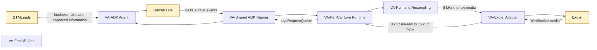
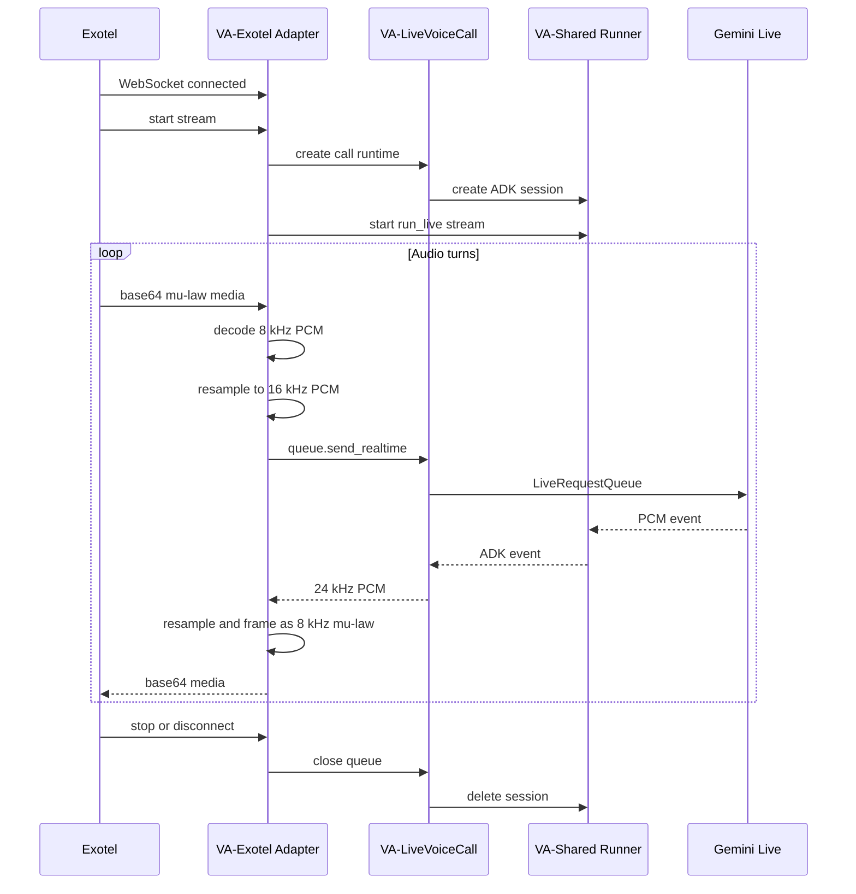

# Voice Platform Programmer Guide

## Purpose

This repository is a reusable FastAPI/ADK voice platform. It can serve GTMLeads.ai now and should support separate business configurations later. The immediate implementation goal is a continuous bidirectional audio conversation between Exotel and Gemini Live.

The project has three transport surfaces:

- Browser microphone conversations through existing ADK/FastAPI routes.
- Inbound telephone audio through the Exotel WebSocket adapter.
- Browser/API-triggered outbound telephone calls in a future milestone. Initiating an outbound call is separate from carrying its live audio.



## Current entry points

- `app/fast_api_app.py` builds the FastAPI application, initializes the shared ADK runner, attaches A2A routes and includes the Exotel router.
- `app/agent.py` defines `root_agent` and the ADK `App`.
- `app/business_config.py` holds the current GTMLeads product configuration.
- `app/instructions.py` converts business configuration into Gemini instructions.
- `app/exotel_adapter.py` translates Exotel WebSocket JSON into call audio operations.
- `app/voice_runtime.py` owns one call's ADK Live session and queue.
- `app/telephony_audio.py` performs in-memory G.711 mu-law conversion and linear PCM resampling.
- `app/gemini_greeting.py` is a completed-generation experiment, not the continuous conversation path.

## Shared objects and per-call objects

The shared runner belongs to the application process. It is stored as `app.state.runner` during the FastAPI lifespan. One runner can serve many calls. Its session service is shared too.

One Exotel WebSocket is one call boundary, but the WebSocket object is not the ADK conversation. On Exotel `start`, `media` creates:

- A unique `LiveVoiceCall` object.
- A unique ADK `user_id`.
- A unique ADK session ID.
- A unique `LiveRequestQueue`.
- One 8 kHz→16 kHz inbound resampler.
- One 24 kHz→8 kHz outbound resampler.
- One outbound byte buffer.
- One ADK event task.

The ADK session remains open across multiple caller turns. These objects belong to only that call and are removed or closed on `stop`, WebSocket disconnect or task failure.

## Call lifecycle



## Audio formats

- Exotel mu-law media: 8 kHz G.711 mu-law, represented in JSON as Base64.
- Gemini input: observed format `audio/pcm;rate=16000` in this implementation.
- Gemini output: PCM16, generally 24 kHz; the code accepts PCM MIME types beginning with `audio/pcm` rather than matching one exact string.
- PCM16 means signed 16-bit integer samples, little-endian in this code.
- Resampling is done in memory with `LinearResampler`; it does not use FFmpeg or intermediate audio files.
- Outbound 160-byte mu-law frames are approximately 20 ms of 8 kHz audio.

## Python concepts

### Imports and modules

An import such as `from app.voice_runtime import LiveVoiceCall` makes a class in another module available in the current file.

### Type annotations

`stream_sid: str | None` means the variable is initially a string or `None`. `asyncio.Task[None]` means a task that runs a coroutine and returns no value.

### Decorators

FastAPI decorators such as `@router.websocket("/media")` register a function as an endpoint.

### Coroutines and async/await

An `async def` function returns a coroutine object. `await` pauses that coroutine while another operation is ready. It does not create a new operating-system thread.

### Tasks and event loop

`asyncio.create_task(...)` schedules a coroutine on the FastAPI process's event loop. The Exotel receive loop and Gemini event loop run as separate tasks. They are cooperative async tasks, not OS processes or threads.

Blocking CPU operations should not run on this event loop. The current conversion routines are small in-memory operations. Future heavy work must use an appropriate worker mechanism.

### Async generators

`Runner.run_live(...)` returns an async generator. `async for event in events` requests one event at a time. `aclosing(events)` makes cleanup explicit if the loop is cancelled or exits early.

### Queue

`LiveRequestQueue` is an ADK bridge. `send_realtime(...)` sends a PCM blob. It remains open while a session is active and is closed during call cleanup.

### Context managers and cancellation

`async with aclosing(events)` is an async context manager. Cancellation stops tasks; `outbound_task.cancel()` asks the event task to stop. `suppress(asyncio.CancelledError)` prevents expected cancellation during cleanup from becoming another error.

## Transcripts, interruptions and tools

The current milestone does not yet implement transcription persistence or playback interruption policies.

Future milestones will:

- Deduplicate partial/final input and output transcription events.
- Retain text with call/session identifiers only, never raw audio payload logs.
- Clear the outbound buffer and cancellation state when Gemini or carrier interruption signals arrive.
- Discard stale local audio after interruption.
- Run ADK-registered tools from the agent; an orchestrator LLM is not needed.
- Store approved call outcomes in a configurable business policy rather than inventing follow-up or registration behavior.

## Configuration

Only variable names are documented here:

- `VOICE_MODEL`
- `GOOGLE_GENAI_USE_ENTERPRISE`
- `GOOGLE_CLOUD_PROJECT`
- `GOOGLE_CLOUD_LOCATION`
- `GEMINI_API_KEY`
- `ALLOW_ORIGINS`
- `SESSION_SERVICE_URI`
- `ARTIFACT_SERVICE_URI`
- `GOOGLE_CLOUD_AGENT_ENGINE_ID`
- `GOOGLE_CLOUD_AGENT_ENGINE_LOCATION`
- `LOGS_BUCKET_NAME`
- `APP_URL`
- `AGENT_VERSION`

Do not read or commit secret values. Exotel credentials remain server-side.

## Local startup and tests

Start the service:

```bash
uv run uvicorn app.fast_api_app:app --host 127.0.0.1 --port 8000
```

Run focused tests:

```bash
uv run pytest tests/test_exotel_adapter.py tests/test_telephony_audio.py -q
```

Check health:

```bash
curl http://127.0.0.1:8000/telephony/exotel/health
```

The test suite does not connect to Exotel or Gemini. A TestClient WebSocket test is only transport-level validation.

## Verification status

Verified locally:

- FastAPI text echo.
- Exotel media fallback behavior without a live runner.
- Mu-law/PCM and even-sized PCM resampler behavior.
- Source files compile in the Pylance editor.

User-reported prior validation:

- Cloudflare reached the Exotel adapter.
- Exotel successfully played a saved Gemini audio greeting.
- Gemini Live generated audio locally.

Not yet verified in this workspace:

- Continuous Gemini Live response streaming from Exotel.
- A real simultaneous carrier/ADK telephone call.
- Cloud Run WebSocket operation.
- Interruption semantics.
- Transcripts and tool execution over a telephone call.

Do not claim telephone or cloud validation until it is actually performed.

## Milestone 2: campaign and call persistence

### Sub-milestone 2.1: campaign persistence and reporting foundation ✅

**Status:** Implemented and locally tested.

Milestone 2 begins with campaign approval and call-record persistence independently from live carrier media. This sub-milestone is the **plumbing for campaign generation and reporting**; it does not initiate an Exotel call.

- `app/campaign_store.py` defines async SQLAlchemy models and CRUD operations.
- `app/campaign_api.py` exposes campaign create/approve/list and call-create/list endpoints.
- `app/fast_api_app.py` initializes and closes the campaign database during application lifespan.
- `tests/test_campaign_store.py` validates approval and reverse-chronological call records.

The default database is a local SQLite file under `data/campaigns.db`. Set `CAMPAIGN_DATABASE_URI` to use another SQLAlchemy async database URI. Set `CAMPAIGN_DB_PATH` to change the default SQLite path.

The current persistence slice does not dial Exotel, authenticate admins or generate reports.

## Remaining milestones

1. Harden SDK integration and test per-call runner/session setup.
2. Verify real incremental inbound and outbound audio on one call.
3. Add interruption, stale-buffer discard and task cancellation policies.
4. Add transcript and call-outcome lifecycle handling.
5. Separate carrier API orchestration for browser/API-triggered outbound calls.
6. Add persistent or distributed session storage only if Cloud Run scaling requires it.
