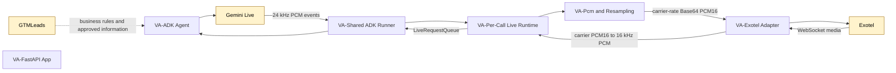
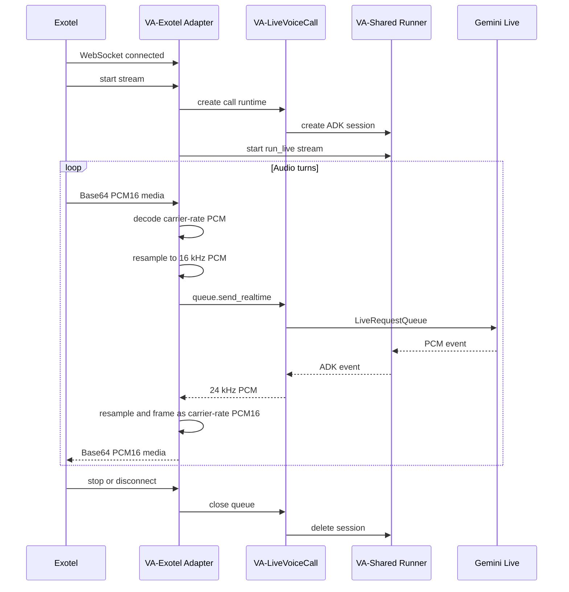

# Voice Platform Programmer Guide

## Purpose

This repository is a reusable FastAPI/ADK voice platform. It can serve GTMLeads.ai now and should support separate business configurations later. The immediate implementation goal is a continuous bidirectional audio conversation between Exotel and Gemini Live.

The project has three transport surfaces:

- Browser microphone conversations through existing ADK/FastAPI routes.
- Inbound telephone audio through the Exotel WebSocket adapter.
- Browser/API-triggered outbound telephone calls in a future milestone. Initiating an outbound call is separate from carrying its live audio.



## Current entry points

- `app/fast_api_app.py` builds the FastAPI application, initializes the shared ADK runner, attaches A2A routes and includes the Exotel router.
- `app/agent.py` defines `root_agent` and the ADK `App`.
- `app/business_config.py` holds the current GTMLeads product configuration.
- `app/instructions.py` converts business configuration into Gemini instructions.
- `app/exotel_adapter.py` translates Exotel WebSocket JSON into call audio operations.
- `app/voice_runtime.py` owns one call's ADK Live session and queue.
- `app/telephony_audio.py` performs in-memory linear PCM16 resampling.
- `app/gemini_greeting.py` is a completed-generation experiment, not the continuous conversation path.

## Shared objects and per-call objects

The shared runner belongs to the application process. It is stored as `app.state.runner` during the FastAPI lifespan. One runner can serve many calls. Its session service is shared too.

One Exotel WebSocket is one call boundary, but the WebSocket object is not the ADK conversation. On Exotel `start`, `media` creates:

- A unique `LiveVoiceCall` object.
- A unique ADK `user_id`.
- A unique ADK session ID.
- A unique `LiveRequestQueue`.
- One 8 kHz→16 kHz inbound resampler.
- One 24 kHz→8 kHz outbound resampler.
- One outbound byte buffer.
- One ADK event task.

The ADK session remains open across multiple caller turns. These objects belong to only that call and are removed or closed on `stop`, WebSocket disconnect or task failure.

## Call lifecycle



## Audio formats

- Exotel media: Base64 PCM16 at 8, 16 or 24 kHz, based on `media_format.sample_rate`.
- Gemini input: observed format `audio/pcm;rate=16000` in this implementation.
- Gemini output: PCM16, generally 24 kHz; the code accepts PCM MIME types beginning with `audio/pcm` rather than matching one exact string.
- PCM16 means signed 16-bit integer samples, little-endian in this code.
- Resampling is done in memory with `LinearResampler`; it does not use FFmpeg or intermediate audio files.
- Outbound media messages contain 3,200 bytes of carrier-rate PCM; a short final message is padded with silence.

## Python concepts

### Imports and modules

An import such as `from app.voice_runtime import LiveVoiceCall` makes a class in another module available in the current file.

### Type annotations

`stream_sid: str | None` means the variable is initially a string or `None`. `asyncio.Task[None]` means a task that runs a coroutine and returns no value.

### Decorators

FastAPI decorators such as `@router.websocket("/media")` register a function as an endpoint.

### Coroutines and async/await

An `async def` function returns a coroutine object. `await` pauses that coroutine while another operation is ready. It does not create a new operating-system thread.

### Tasks and event loop

`asyncio.create_task(...)` schedules a coroutine on the FastAPI process's event loop. The Exotel receive loop and Gemini event loop run as separate tasks. They are cooperative async tasks, not OS processes or threads.

Blocking CPU operations should not run on this event loop. The current conversion routines are small in-memory operations. Future heavy work must use an appropriate worker mechanism.

### Async generators

`Runner.run_live(...)` returns an async generator. `async for event in events` requests one event at a time. `aclosing(events)` makes cleanup explicit if the loop is cancelled or exits early.

### Queue

`LiveRequestQueue` is an ADK bridge. `send_realtime(...)` sends a PCM blob. It remains open while a session is active and is closed during call cleanup.

### Context managers and cancellation

`async with aclosing(events)` is an async context manager. Cancellation stops tasks; `outbound_task.cancel()` asks the event task to stop. `suppress(asyncio.CancelledError)` prevents expected cancellation during cleanup from becoming another error.

## Transcripts, interruptions and tools

The current milestone does not yet implement transcription persistence or playback interruption policies.

Future milestones will:

- Deduplicate partial/final input and output transcription events.
- Retain text with call/session identifiers only, never raw audio payload logs.
- Clear the outbound buffer and cancellation state when Gemini or carrier interruption signals arrive.
- Discard stale local audio after interruption.
- Run ADK-registered tools from the agent; an orchestrator LLM is not needed.
- Store approved call outcomes in a configurable business policy rather than inventing follow-up or registration behavior.

## Configuration

Only variable names are documented here:

- `VOICE_MODEL`
- `GOOGLE_GENAI_USE_ENTERPRISE`
- `GOOGLE_CLOUD_PROJECT`
- `GOOGLE_CLOUD_LOCATION`
- `GEMINI_API_KEY`
- `ALLOW_ORIGINS`
- `SESSION_SERVICE_URI`
- `ARTIFACT_SERVICE_URI`
- `GOOGLE_CLOUD_AGENT_ENGINE_ID`
- `GOOGLE_CLOUD_AGENT_ENGINE_LOCATION`
- `LOGS_BUCKET_NAME`
- `APP_URL`
- `AGENT_VERSION`

Do not read or commit secret values. Exotel credentials remain server-side.

## Local startup and tests

Start the service:

```bash
uv run uvicorn app.fast_api_app:app --host 127.0.0.1 --port 8000
```

Run focused tests:

```bash
uv run pytest tests/test_exotel_adapter.py tests/test_telephony_audio.py -q
```

Check health:

```bash
curl http://127.0.0.1:8000/telephony/exotel/health
```

The test suite does not connect to Exotel or Gemini. A TestClient WebSocket test is only transport-level validation.

### Simulate Exotel locally

Start the service with the command above and the existing Gemini credentials configured. For a live conversation, open `scripts/exotel_live.html` in a browser, click **Start conversation**, and allow microphone access. Use headphones to avoid feeding speaker audio back into the microphone. Click **Stop** to end the simulation. The page connects only to the local service and sends microphone audio as simulated Exotel PCM media; Gemini still requires network access. Browser microphone permissions apply. Interruption handling is not implemented, so already queued playback may continue when you speak.

Alternatively, in another terminal, send a recording of the caller:

```bash
.venv/bin/python scripts/simulate_exotel.py caller.wav --output response.wav --wait 15
afplay response.wav
```

The input must be a mono, signed 16-bit PCM WAV at 8, 16, or 24 kHz. The simulator sends 20 ms frames in real time over the localhost Exotel WebSocket and saves the returned PCM as a WAV at the same rate. The wait starts after the recording finishes; increase it for a slow response. This exercises the local bridge and the configured Gemini Live service, so it requires working Gemini credentials and may incur model charges. It does not connect to Exotel or place a telephone call. It does not reproduce carrier buffering, network behavior, or an interactive microphone conversation. Check server logs if no audio arrives.

On the current Anaconda Python environment, pytest may crash importing `readline`. A local workaround for the focused tests is:

```bash
.venv/bin/python -c 'import sys, types; sys.modules["readline"] = types.ModuleType("readline"); import pytest; raise SystemExit(pytest.main(["tests/test_exotel_adapter.py", "tests/test_telephony_audio.py", "-q"]))'
```

## Verification status

Verified locally:

- FastAPI text echo.
- Exotel media fallback behavior without a live runner.
- PCM media decoding and even-sized PCM resampler behavior.
- Source files compile in the Pylance editor.

User-reported prior validation:

- Cloudflare reached the Exotel adapter.
- Exotel successfully played a saved Gemini audio greeting.
- Gemini Live generated audio locally.
- A live Exotel call played Gemini audio clearly after outbound framing was changed to 3,200 bytes.

Not yet verified in this workspace:

- Continuous Gemini Live response streaming from Exotel.
- Full multi-turn telephone conversation and interruption behavior.
- Cloud Run WebSocket operation.
- Interruption semantics.
- Transcripts and tool execution over a telephone call.

Do not claim telephone or cloud validation until it is actually performed.

## Milestone 2: campaign and call persistence

### Outbound call implementation plan

Each call has our own UUID before contacting Exotel. The intended flow uses that ID to connect the initial request, status callbacks and audio stream to one record even when they arrive in a different order. Exotel's [Voice AI API](https://developer.exotel.com/docs/agentstream/connect-voice-ai) documents `CustomField`, `StreamUrl`, `StatusCallback` and its returned call SID. We must verify how our ID is carried to the media WebSocket and authenticate external requests before relying on it. A UUID alone is not authentication.

Implement in slices: (1) safe call reservation and ID association; (2) an Exotel client tested with a fake HTTP transport; (3) authenticated status and media correlation, using approved campaign context in the per-call session; (4) a user-authorized live call. Callbacks can be repeated or out of order; terminal states must not be rolled back. A timed-out dial request may have reached Exotel, so never automatically retry it as though it definitely failed. This plan does not yet define migrations, callback authentication, retry reconciliation or the complete status transition table.

The first local slice adds `get_call`, `claim_queued_call` and `bind_exotel_call` to `CampaignStore`. Claiming uses a conditional database update so two concurrent workers cannot both reserve the same queued call. Binding accepts the same SID again but rejects a different one for that record. No API invokes these methods yet, and they do not contact Exotel. There is no database constraint guaranteeing that a SID cannot be attached to two different records; resolve that before using SID-only lookup.

The next slice adds `app/exotel_client.py`. It builds the documented Voice AI multipart request with the destination number, ExoPhone, bidirectional WebSocket URL, our call ID in `CustomField`, and answered/terminal callback settings. Its tests use a fake HTTP session: no Exotel credentials or network access are needed. Errors deliberately do not trigger retries: Exotel may have received a request even when our server did not receive its response.

`app/outbound_calls.py` coordinates the store and client: it claims a queued record, makes one request, and binds the returned SID. A reported carrier error changes an unbound dialing record to `dial_outcome_unknown`, preventing another attempt until a future reconciliation procedure resolves it. A process crash, cancellation, unexpected validation error, or failure while saving the SID can leave the record in `dialing`; treat that as uncertain too. The call-start endpoint can use the coordinator when explicitly configured, but no real service is installed by default. The tests use a fake client and cover concurrent requests and uncertain outcomes. Reconciliation, duplicate-SID protection, callbacks and authentication still need work before enabling real dialing.

`CampaignStore.record_carrier_event` is internal groundwork for correlation. It takes our call ID and Exotel's call SID, and optionally the stream SID when answered. It can bind the SID before the outbound request returns, accepts duplicate identical events, rejects conflicting IDs, and does not let late answered or conflicting final events replace a terminal status. It records server receipt time, not the provider's actual event time. It rejects late or conflicting events with `ValueError`; a future callback handler must decide how to acknowledge those without endless provider retries. The method does not authenticate events, validate SID uniqueness across records, or expose a callback or WebSocket integration. The [Exotel start event](https://developer.exotel.com/docs/agentstream/websocket-protocol) includes a call SID and custom parameters, but the docs do not establish that the outbound `CustomField` automatically appears in those parameters. Verify the correlation path and authentication before connecting it to live traffic.

`app/exotel_events.py` parses Exotel's documented `CustomField`, `CallSid`, `EventType` and terminal `Status` fields, then applies the event through the store. `/telephony/exotel/status` accepts form or JSON callbacks; `/telephony/exotel/outbound-media` expects `start.custom_parameters.call_id` and matches the stream to a record before starting the existing bridge. The client appends `call_id` to `StreamUrl`; if an existing query already has it, the request is rejected. A `call_id` in the incoming WebSocket URL, when present, must agree with the start event. Both endpoints require async verifiers on application state (`exotel_callback_verifier` and `exotel_stream_verifier`) and deny requests when absent. Only tests configure fake verifiers. The existing `/media` path remains separate for the established simulator and earlier call flow; it is not protected by these new verifiers. No production verifier is configured, and the outbound client is not yet wired to these endpoints. A call identifier is not proof of origin.

[Exotel's webhook security guidance](https://developer.exotel.com/docs/references/authentication) recommends HTTPS, source-IP verification and payload validation. It does not document a status-callback signature here, so do not assume that a callback is authentic merely because it contains the expected IDs. Verify actual delivery and configure a trusted ingress before using the handler. Exotel documents Basic Auth for a separate ExoML event endpoint; that does not establish support for Voice AI status callbacks. Late or conflicting events currently return HTTP 409 and require a retry/acknowledgement policy before real traffic.

`tests/test_exotel_correlation.py` exercises the coordinator, callback endpoint and audio WebSocket together with a fake carrier and test-only verifier. It deliberately delivers the callback and stream before the fake outbound request returns its SID. This checks ordering and record correlation in process, but uses the no-runner audio echo; it does not exercise Gemini, the real Exotel client, source authentication or a public tunnel.

Another test in the same file runs the real `LiveVoiceCall` with a fake ADK runner and session service. It checks that the right campaign context and resampled caller audio reach the live request queue, that audio returns through the adapter, and that the session is deleted at the end. The test does not connect to Gemini or validate what Gemini says.

For a correlated outbound stream, the adapter retrieves the approved campaign and passes the campaign name, business name and seller name as a JSON-formatted startup message to the per-call runtime. The phone number is not included. The message tells the model to treat these values as data, but that wording alone does not guarantee protection from instructions embedded in user-entered names. A fake-runtime test checks which values are passed; actual model behavior, input validation and authorization of campaign content need further testing before production.

#### Exotel plan and integration checks

- The [Connect Voice AI documentation](https://developer.exotel.com/docs/agentstream/connect-voice-ai) describes the desired outbound call to an external bidirectional WebSocket. The commercial proposal describes streaming and outbound calls but does not explicitly guarantee this API is enabled on the account. A previous successful Voicebot stream confirms that streaming worked for that earlier call; it does not verify the new plan's Connect API entitlement.
- [Call status documentation](https://developer.exotel.com/docs/voice-v1/api-reference/call-details) lists `CustomField` and `CallSid` in callbacks, which supports linking the callback to our record. Confirm actual payloads and sender verification before accepting live updates.
- The [Voicebot FAQ](https://support.exotel.com/support/solutions/articles/3000112112-voicebot-faqs) supports URL query parameters for Voicebot applet endpoints. It does not establish that Connect Voice AI's `CustomField` is automatically forwarded to the WebSocket, or that a different per-call query URL is accepted by that API. The [product chooser](https://developer.exotel.com/docs/agentstream/what-to-use-when) describes Connect Voice AI as appropriate when a fixed stream URL is sufficient. Confirm the desired Connect API behavior before relying on a per-call URL.
- Request Exotel's current callback and WebSocket source IP ranges, and confirm how their authentication works for this account. When using Cloudflare, configure and verify source restrictions at a trusted ingress; the immediate peer seen by the laptop may be the tunnel rather than Exotel. Do not trust unverified forwarding headers or call IDs as proof of origin.
- `DirectSourceVerifier` in `app/exotel_verification.py` checks an explicitly configured IP/CIDR allowlist against the ASGI socket peer, ignoring forwarded headers. It is not installed by default. Use it only for direct connections when the server does not rewrite client addresses from proxy headers (for Uvicorn, disable proxy headers) and no reverse proxy intervenes. It is not appropriate for Cloudflare Tunnel: a local process can connect directly and forge an HTTP header, and the immediate peer is cloudflared. IP filtering is not cryptographic authentication. Confirm separate, current Exotel source ranges for WebSockets and callbacks, and configure restrictions at a trusted Cloudflare ingress with no bypass path before connecting the verifier or accepting live traffic. See [Cloudflare's header guidance](https://developers.cloudflare.com/fundamentals/reference/http-headers/) and [origin protection](https://developers.cloudflare.com/fundamentals/security/protect-your-origin-server/).
- `POST /campaigns/{campaign_id}/calls/{call_id}/start` calls the outbound service only if application state provides both `outbound_request_verifier` and `outbound_call_service`; neither is installed by default. It validates the campaign association and rejects duplicate requests. Tests inject a fake verifier and fake carrier; they do not prove real authentication. Campaign creation/listing routes predate this feature and are not protected by that verifier. Configure real user authorization and secure all campaign routes before exposing the application.
- A read-only Exotel call-list request using the existing local account configuration returned HTTP 200. This checks basic API access only; it does not establish that the account matches the new proposal or that Connect Voice AI is enabled. No call was initiated by this check.
- A later user-authorized diagnostic call through an isolated temporary tunnel returned HTTP 200 from Connect, followed by a terminal callback reporting `no-answer`. The callback included a call SID and the matching `CustomField`, and did not contain an Authorization header. A Cloudflare connecting-IP header was present, but its presence alone does not authenticate the source. The call was not answered, so no WebSocket behavior was observed. The Connect HTTP response was not recognized as the JSON response expected by our client; inspect the real response format safely before enabling dialing. No retry was made, and the diagnostic server and tunnel were stopped.
- A second user-requested diagnostic call also ended with `no-answer` and did not open a WebSocket. Its successful Connect response was `application/xml` with a `TwilioResponse/Call/Sid` and `in-progress` status. The current JSON-only client cannot handle that response; correct and test the response handling before enabling it. The terminal callback again contained our `CustomField` and no Authorization header. The temporary server and tunnel were stopped.
- A third user-requested diagnostic call was answered. Exotel opened the WebSocket, whose `start` event contained its call SID, stream SID, 8 kHz sample rate and the test identifier in `custom_parameters`. The identifier had been supplied in both `StreamUrl`'s query and `CustomField`, so this test does not distinguish which source populated the custom parameter. The WebSocket URL query observed by the server did not contain `call_id`, and neither the connection nor the answered callback supplied an Authorization header. A Cloudflare connecting-IP header was present but is not independently verified authentication. The temporary diagnostic emitted silence and was stopped with its tunnel; no final callback was observed before shutdown.
- The client now accepts the observed XML response as well as JSON and treats malformed, oversized or missing-SID responses as uncertain. The adapter expects a `call_id` key in the stream start's custom parameters, matching the parameter it sends in `StreamUrl`.
- A fourth user-authorized silent diagnostic call confirmed that Exotel moves the `call_id` URL parameter into `start.custom_parameters.call_id`: the stream start contained the expected name and value when `CustomField` was deliberately different. Exotel reported answered and completed callbacks. Neither the stream nor callbacks contained an Authorization header; source verification remains necessary. The temporary diagnostic server and tunnel were stopped.
- A subsequent user-authorized call exercised the real outbound coordinator, client, correlation endpoints and Gemini Live with a separate temporary campaign database. The application saved the provider SID, matched the media stream, sent and received audio, and recorded `completed`. The stream ran about 109 seconds; its first Gemini audio was sent about 13.7 seconds after WebSocket connection. The user reported that the conversation worked perfectly; logs alone do not establish transcript content or whether the model used the supplied context. The test used a temporary secret URL and a test-only verifier, not production authentication. Its server, tunnel and temporary test data were removed afterward.

For a later laptop test, the web screen will talk to our local server, and Exotel will use a public `wss://` address pointing through Cloudflare to `/telephony/exotel/media`. Status callbacks also need a reachable HTTPS address. The tunnel address and server must remain available throughout the call. Before enabling this path, implement authentication and confirm the call ID's route to the WebSocket; `CustomField` in the dial request alone does not prove that it appears in the WebSocket start event.

### Sub-milestone 2.1: campaign persistence and reporting foundation ✅

**Status:** Implemented and locally tested.

Milestone 2 begins with campaign approval and call-record persistence independently from live carrier media. This sub-milestone is the **plumbing for campaign generation and reporting**; it does not initiate an Exotel call.

- `app/campaign_store.py` defines async SQLAlchemy models and CRUD operations.
- `app/campaign_api.py` exposes campaign create/approve/list and call-create/list endpoints.
- `app/fast_api_app.py` initializes and closes the campaign database during application lifespan.
- `tests/test_campaign_store.py` validates approval and reverse-chronological call records.

The default database is a local SQLite file under `data/campaigns.db`. Set `CAMPAIGN_DATABASE_URI` to use another SQLAlchemy async database URI. Set `CAMPAIGN_DB_PATH` to change the default SQLite path.

The current persistence slice does not dial Exotel, authenticate admins or generate reports.

## Remaining milestones

1. Harden SDK integration and test per-call runner/session setup.
2. Verify real incremental inbound and outbound audio on one call.
3. Add interruption, stale-buffer discard and task cancellation policies.
4. Add transcript and call-outcome lifecycle handling.
5. Separate carrier API orchestration for browser/API-triggered outbound calls.
6. Add persistent or distributed session storage only if Cloud Run scaling requires it.
