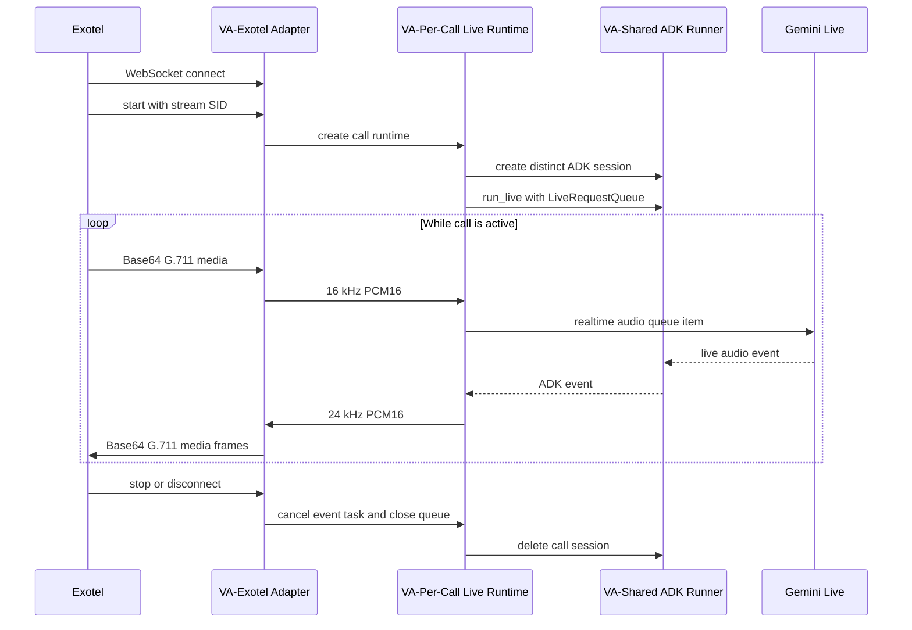

# Voice Platform Architecture

This document is the maintained architecture record for the voice platform. Update it after each implementation milestone. The detailed teaching guide remains in `docs/PROGRAMMER_GUIDE.md`.

## Milestone 1 — Per-call Exotel-to-ADK Live streaming skeleton

### Mental model

A phone call has two jobs: **move audio** and **conduct the conversation**.

- Exotel owns the telephone connection and sends audio as a WebSocket stream.
- `app/exotel_adapter.py` translates Exotel audio into Gemini input and Gemini output back into Exotel media.
- `app/voice_runtime.py` owns the Gemini conversation for exactly one call.
- The shared FastAPI application owns the runner, agent and session services used by every call.

In other words:

```text
Exotel ⇄ carrier adapter ⇄ per-call ADK runtime ⇄ Gemini Live
                         ↑
                 shared agent/runner
```

**Status:** Implemented; focused tests pass.
**Validated:** Local unit and TestClient behavior.
**Not yet validated:** Real Exotel telephone traffic, Cloud Run WebSockets, Gemini end-to-end telephone playback, interruptions or tool/transcript behavior.

### Architecture diagram

```mermaid
flowchart LR
    GTM[GTMLeads]:::external
    EX[Exotel]:::external
    GEM[Gemini Live]:::external

    VAAPI[VA-FastAPI App]
    VAADK[VA-ADK Agent]
    VARUN[VA-Shared ADK Runner]
    VAEX[VA-Exotel Adapter]
    VACALL[VA-Per-Call Live Runtime]
    VAAUDIO[VA-PCM and Audio Conversion]

    EX -->|WebSocket JSON and media| VAEX
    VAEX -->|Exotel 8 kHz mu-law| VAAUDIO
    VAAUDIO -->|16 kHz PCM16| VACALL
    VACALL -->|LiveRequestQueue| VARUN
    VARUN --> VAADK
    VAADK --> GEM

    GEM -->|24 kHz PCM events| VARUN
    VARUN --> VACALL
    VACALL --> VAAUDIO
    VAAUDIO -->|8 kHz mu-law frames| VAEX
    VAEX -->|WebSocket media| EX

    GTM -. approved business information .-> VAADK

    classDef external fill:#fff3cd,stroke:#9a6700,color:#000
```



## Component responsibilities

- **VA-FastAPI App** — owns process startup, shared ADK runner state and route registration.
- **VA-ADK Agent** — retains the existing agent, model, business instructions and future ADK tools.
- **VA-Shared ADK Runner** — shared across all calls and serving surfaces.
- **VA-Exotel Adapter** — owns Exotel WebSocket protocol handling and stream IDs.
- **VA-Per-Call Live Runtime** — creates and closes one ADK Live session and queue for one call.
- **VA-PCM and Audio Conversion** — decodes/encodes G.711 mu-law and resamples PCM in memory.
- **Exotel** — external carrier and transport provider.
- **Gemini Live** — external bidirectional audio model.
- **GTMLeads** — external/business owner represented by configuration and instructions.

## Shared versus per-call state

Shared by the application process:

- `app.state.runner`
- `app.state.agent_app_name`
- ADK agent/app definitions
- Session and artifact service instances

Owned by a single Exotel stream/call:

- Exotel WebSocket and stream ID
- ADK `user_id` and `session_id`
- `LiveRequestQueue`
- Inbound 8 kHz→16 kHz resampler
- Outbound 24 kHz→8 kHz resampler
- Outbound mu-law byte buffer
- Gemini event-consumer task
- Call logs and future transcript/outcome state

## Audio call lifecycle



## Milestone 1 accomplishments

- **Each phone call gets isolated state**

  - Its own ADK session, `LiveRequestQueue`, resampling state, audio buffer and background task.
  - Concurrent calls no longer share conversation state.

- **Exotel audio enters Gemini Live**

  - Mu-law audio is Base64-decoded.
  - Converted from 8 kHz PCM to 16 kHz PCM.
  - Sent to Gemini through `LiveRequestQueue`.

- **Gemini audio returns to Exotel**

  - ADK events are consumed in the background.
  - 24 kHz PCM is resampled to 8 kHz.
  - PCM is converted to G.711 mu-law and framed for Exotel as Base64 media.

- **Cleanup is scoped to one call**

  - ADK tasks and queues are cancelled or closed on disconnect, `stop`, or failure.
  - The session is deleted when the session service supports deletion.

- **The carrier remains separate from agent logic**

  - `app/exotel_adapter.py` handles carrier protocol and audio framing.
  - `app/voice_runtime.py` manages ADK sessions and Gemini Live events.
  - The existing agent instructions and business configuration remain unchanged.

- **The smallest runtime skeleton is now complete**

  - It supports the intended architecture, but it still needs real end-to-end and interrupt testing.
  - It does not yet send a live greeting or establish browser-triggered outbound calls.

## Remaining pending work

- Verify real incremental Gemini Live audio through Exotel.
- Verify ADK session creation and event streaming with the shared application runner.
- Add interruptions and stale outbound-buffer clearing.
- Add partial/final transcription handling.
- Add tool execution and call-outcome configuration.
- Add browser/API outbound-call initiation.
- Add bounded buffering/timeouts and production logging policies.
- Add Cloud Run and Exotel production validation.

## File changes for Milestone 1

### New files

- `app/voice_runtime.py` — per-call ADK Live session and `LiveRequestQueue` runtime.
- `app/telephony_audio.py` — mu-law conversion and stateful PCM resampling.
- `tests/test_telephony_audio.py` — PCM and resampler unit tests.
- `docs/PROGRAMMER_GUIDE.md` — teaching guide for architecture and Python concepts.
- `docs/architecture.md` — maintained architecture and milestone record.

### Modified files

- `app/exotel_adapter.py` — replaced static greeting playback with the per-call transport skeleton and concurrent ADK event consumption.
- `tests/test_exotel_adapter.py` — updated the media transport test to the no-runner fallback behavior.

## Validation record

The focused command currently used:

```bash
uv run pytest tests/test_exotel_adapter.py tests/test_telephony_audio.py -q
```

Observed result: `5 passed, 1 warning`.

This validates local text/media fallback and audio helper behavior. It does not validate live telephony or cloud deployment.
