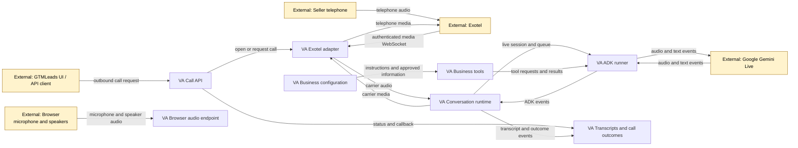
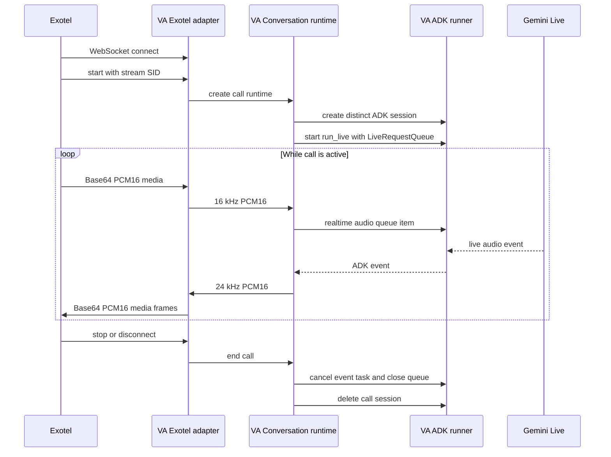

# Voice Platform Architecture

This document is the maintained architecture record for the voice platform. Update it after each implementation milestone. The detailed teaching guide remains in `docs/PROGRAMMER_GUIDE.md`.

## Architecture scope

This platform supports both browser and telephone conversations:

- A browser can use microphone/speaker audio directly or trigger an outbound telephone call.
- GTMLeads or another business can request outbound calls through a VA Call API.
- Exotel owns the telephone connection and streams telephone media over WebSocket.
- Gemini Live generates and receives conversation audio through the shared application runtime.
- VA Business Tools and VA Business Configuration supply approved instructions and enforce business rules.
- The conversation runtime can save transcripts and call outcomes for later reference.

```text
Browser / GTMLeads UI
           |
           v
      VA Call API
           |
           v
VA Exotel Adapter -> VA Conversation Runtime -> Gemini Live
           |                    |
           v                    v
       Exotel            VA Tools / Config / Results
           |
           v
    Seller's phone
```

A reusable product boundary is the **VA Conversation Runtime**. It should remain independent of Exotel-specific WebSocket messages so other carriers can be added later.

## Milestone 1 — Per-call Exotel-to-ADK Live streaming skeleton

**Status:** Implemented; focused tests pass.

**Validated locally:** Text echo, media fallback behavior, PCM16 helpers and dynamic resampling.

**User-validated:** Gemini audio played clearly on a real Exotel call after the PCM16 and 3,200-byte framing corrections.

**Not yet validated:** Full multi-turn telephone behavior, browser-triggered outbound calls, Cloud Run WebSockets, interruptions, transcripts or tool execution.

### Mental model

A phone call has two jobs: **move audio** and **conduct the conversation**.

- Exotel owns the telephone connection and sends audio as a WebSocket stream.
- `app/exotel_adapter.py` translates Exotel audio into Gemini input and Gemini output back into Exotel media.
- `app/voice_runtime.py` owns the Gemini conversation for exactly one call.
- The shared FastAPI application owns the runner, agent and session services used by every call.

In other words:

```text
Exotel ⇄ carrier adapter ⇄ per-call ADK runtime ⇄ Gemini Live
                         ↑
                 shared agent/runner
```

### Architecture diagram



## Component responsibilities

- **VA Call API** — receives outbound-call requests and reports call status or callback results.
- **VA Browser audio endpoint** — connects browser microphone/speaker audio to the conversation runtime.
- **VA Exotel adapter** — translates Exotel WebSocket events and carrier media into calls that the conversation runtime can process.
- **VA Conversation runtime** — owns live call state and combines carrier transport, ADK events and audio conversion.
- **VA ADK runner** — runs the shared agent definition with Gemini Live and registered tools.
- **VA Business tools** — execute registered ADK actions and enforce business authorization and rules.
- **VA Business configuration** — supplies approved business information and configurable instructions.
- **VA Transcripts and call outcomes** — stores conversation text, call status and final outcomes for later reference.
- **Exotel** — external carrier that establishes telephone calls and streams Base64 PCM16 audio at the configured sample rate.
- **Google Gemini Live** — external model that generates and receives real-time audio and text events.
- **GTMLeads / API client** — external business UI or service that triggers and observes calls.

## Shared versus per-call state

Shared by the application process:

- `app.state.runner`
- `app.state.agent_app_name`
- ADK agent/app definitions
- Session and artifact service instances

Owned by a browser or telephone call:

- Browser WebSocket/audio stream or Exotel WebSocket and stream ID
- ADK `user_id` and `session_id`
- `LiveRequestQueue`
- Carrier and PCM resampling state
- Outbound audio buffer
- Gemini/ADK event-consumer task
- Call logs, transcript and outcome state

The existing implementation creates this per-call state for Exotel. Browser and outbound-call orchestration remain pending.

## Audio call lifecycle

### Telephone call — Milestone 1 implementation



### Browser and outbound-call surfaces

- **Browser conversation:** the browser sends microphone audio to the VA browser audio endpoint, which uses the VA conversation runtime and shared VA ADK runner.
- **Browser-triggered telephone call:** the browser or GTMLeads UI/API client first requests an outbound call through the VA Call API. The call remains independent of the browser session after initiation.
- **Outbound call transport:** the VA Exotel adapter opens and manages the carrier call, while the VA conversation runtime continues the Gemini Live conversation.
- **Results:** transcripts and call outcomes are produced after or during the call and stored in VA transcripts/call-outcome references.

These browser and outbound-call surfaces are part of the target platform but are not implemented by the current Exotel skeleton.

## Milestone 1 accomplishments

- **Each phone call gets isolated state**

  - Its own ADK session, `LiveRequestQueue`, resampling state, audio buffer and background task.
  - Concurrent calls no longer share conversation state.

- **Exotel audio enters Gemini Live**

  - Base64 PCM16 audio is decoded.
  - Carrier-rate PCM is resampled to 16 kHz PCM.
  - PCM is sent to Gemini through `LiveRequestQueue`.

- **Gemini audio returns to Exotel**

  - ADK events are consumed in the background.
  - 24 kHz PCM is resampled to Exotel's configured carrier rate.
  - PCM16 is framed and Base64-encoded for Exotel media events.

- **Cleanup is scoped to one call**

  - ADK tasks and queues are cancelled or closed on disconnect, `stop`, or failure.
  - The session is deleted when the session service supports deletion.

- **The carrier remains separate from agent logic**

  - `app/exotel_adapter.py` handles carrier protocol and audio framing.
  - `app/voice_runtime.py` manages ADK sessions and Gemini Live events.
  - The existing agent instructions and business configuration remain unchanged.

- **The smallest runtime skeleton is now complete**

  - It supports the intended architecture, but it still needs real end-to-end and interrupt testing.
  - It does not yet send a live greeting or establish browser-triggered outbound calls.

## Remaining pending work

- Verify real incremental Gemini Live audio through Exotel.
- Verify ADK session creation and event streaming with the shared application runner.
- Add interruptions and stale outbound-buffer clearing.
- Add partial/final transcription handling.
- Add tool execution and call-outcome configuration.
- Add browser/API outbound-call initiation.
- Add bounded buffering/timeouts and production logging policies.
- Add Cloud Run and Exotel production validation.

## File changes for Milestone 1

### New files

- `app/voice_runtime.py` — per-call ADK Live session and `LiveRequestQueue` runtime.
- `app/telephony_audio.py` — stateful PCM16 resampling.
- `tests/test_telephony_audio.py` — PCM and resampler unit tests.
- `docs/PROGRAMMER_GUIDE.md` — teaching guide for architecture and Python concepts.
- `docs/architecture.md` — maintained architecture and milestone record.

### Modified files

- `app/exotel_adapter.py` — replaced static greeting playback with the per-call transport skeleton and concurrent ADK event consumption.
- `tests/test_exotel_adapter.py` — updated the media transport test to the no-runner fallback behavior.

## Validation record

The focused command currently used:

```bash
uv run pytest tests/test_exotel_adapter.py tests/test_telephony_audio.py -q
```

Observed result: `5 passed, 1 warning`.

This validates local text/media fallback and audio helper behavior. It does not validate live telephony or cloud deployment.

## Milestone 2 — Campaign and outbound call records

### Sub-milestone 2.1 — Campaign persistence and reporting foundation ✅

**Status:** Implemented and locally tested.

This sub-milestone provides the **campaign approval and reporting plumbing**. It does **not** initiate an Exotel call.

It currently supports:

- Creating campaign records.
- Approving a campaign before calls may be added.
- Creating individual queued call records for approved campaigns.
- Listing call records newest-first for future admin/report views.
- Storing the fields needed to correlate and report real calls later.

It does not yet:

- Dial a seller through Exotel.
- Upload or validate seller spreadsheets.
- Authenticate Gmail administrators.
- Receive real Exotel status callbacks.
- Record live transcripts or outcomes.
- Generate or download an XLSX report.

- **Campaign records are isolated from live media**

  - Campaign approval is stored separately from individual calls.
  - A call can only be created after campaign approval.

- **Call records support operational reporting**

  - Seller name and normalized phone number are stored.
  - Exotel call SID and media stream SID fields support correlation.
  - Status, timestamps, transcript, outcome, trace URI and error fields are modeled.
  - Calls are returned newest-first for future report and admin views.

- **Local SQLite is the first storage implementation**

  - Async SQLAlchemy and `aiosqlite` require no Redis or separate database service.
  - `CAMPAIGN_DATABASE_URI` permits a later PostgreSQL/Cloud SQL URI.
  - This implementation does not dial a seller or require Exotel credentials.

- **Campaign API is server-side**

  - Create and approve campaigns.
  - Create queued calls only under approved campaigns.
  - List calls in reverse chronological order.

### Remaining Milestone 2 work

- Spreadsheet upload and seller validation.
- Gmail OAuth and company authorization.
- Exotel REST outbound-call initiation.
- Live call-ID to media-stream correlation.
- Status callbacks and completion lifecycle.
- Transcript, trace, outcome and XLSX report generation.
- Admin download endpoints and UI.
